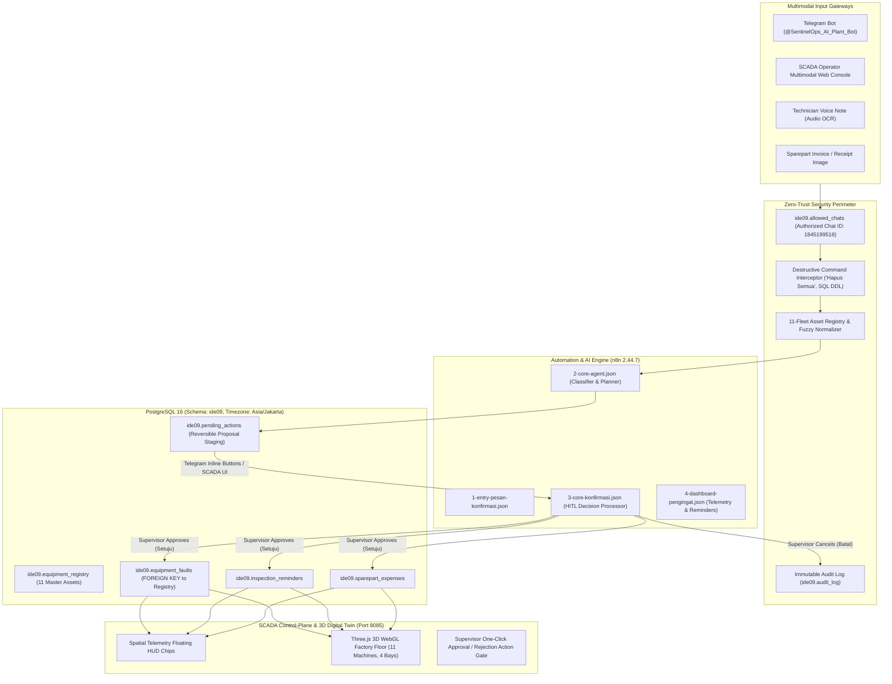

# 🏭 SentinelOps AI

> **Governed Smart Manufacturing & Predictive Maintenance Copilot with 3D Spatial Digital Twin**  
> *Strict Human-in-the-Loop (HITL) Control-Plane • Multimodal OCR & Voice • PostgreSQL 16 (`ide09` WIB)*

[](https://www.postgresql.org/)
[](https://n8n.io/)
[](https://threejs.org/)
[-brightgreen.svg)]()
[]()

---

## 📌 Executive Overview

**SentinelOps AI** is an industrial-grade Smart Manufacturing Copilot engineered for plant engineers, supervisors, and operations managers. It merges high-throughput industrial event processing, multimodal AI (voice notes and receipt OCR), and interactive 3D WebGL Digital Twin visualization with zero-trust safety constraints:

1. **Strict Human-in-the-Loop (HITL) Governance:** The AI cannot execute destructive database mutations or financial commitments autonomously. All maintenance proposals stage in `ide09.pending_actions` and require explicit cryptographic confirmation from authorized supervisors.
2. **11-Machine Photorealistic 3D Digital Twin:** Procedural Three.js spatial visualizer rendering plant assets across 4 industrial bays, featuring real-time telemetry synchronization, ACES tone mapping, dynamic conveyor motion, molten thermal core glow, and camera bay presets.
3. **Canonical Asset Fleet Guardrail:** Fault reporting is strictly bound to the 11 registered Digital Twin machinery assets via fuzzy alias matching, preventing hallucinated tags and enforcing PostgreSQL foreign key constraints.
4. **Adversarial Prompt-Injection Defense:** Receipts, invoices, and operator notes containing malicious prompt-injection payloads are neutralized into untrusted data fields without executing unauthorized commands.
5. **Full WIB (Asia/Jakarta) Auditability:** Every action, decision, reminder, and security violation is cryptographically recorded in `ide09.audit_log`.

---

## 🏛️ System Architecture



---

## 🏭 11-Machine Digital Twin Fleet

The plant floor model is structured into 4 distinct production bays:

| Production Bay | Canonical Tag | Machine Name | Line / Area | Alias Examples |
| :--- | :--- | :--- | :--- | :--- |
| **Bay 1: Rolling Mill** | `CONV-L1` | Feed Line Conveyor 1 | Rolling Mill Line 1 | *conveyor 1, conv l1, feed conveyor* |
| | `CONV-L2` | Main Heavy Conveyor 2 | Rolling Mill Line 2 | *conv-l2, conveyor utama, line 2* |
| | `CONV-L3` | Finishing Conveyor 3 | Rolling Mill Line 3 | *conv-l3, conveyor 3, finishing line* |
| **Bay 2: Melting Shop** | `FURNACE-01` | Electric Arc Furnace 01 | Melting Shop Bay A1 | *furnace 1, tungku 1, arc furnace 01* |
| | `FURNACE-02` | Electric Arc Furnace 02 | Melting Shop Bay A2 | *furnace 2, tungku 2, arc furnace 02* |
| | `FURNACE-03` | Electric Arc Furnace 03 | Melting Shop Bay A3 | *furnace 3, tungku 3, arc furnace 03* |
| **Bay 3: Substation** | `MCC-PANEL-A` | Substation Feeder Panel A | Substation Feeder A | *mcc a, panel a, feeder a, substation* |
| | `MCC-PANEL-B` | Substation Feeder Panel B | Substation Feeder B | *mcc b, panel b, feeder b* |
| | `MCC-PANEL-C` | Substation Feeder Panel C | Substation Feeder C | *mcc c, panel c, feeder c* |
| **Bay 4: Utilities** | `HYD-PRESS-03` | Hydraulic Forging Press 03 | Heavy Forging Press Bay | *mesin press, hyd press, forging press* |
| | `MOTOR-PUMP-04` | Water Treatment Pump 04 | Water Treatment Station | *pompa wtp, water pump, pompa pendingin* |

---

## 🚀 Quickstart: Local Docker Deployment

### Prerequisites
- [Docker Engine & Docker Compose](https://docs.docker.com/get-docker/) (v24+)
- Python 3.10+ (for running the compliance test suite)

### 1. Clone & Configure Environment
```bash
git clone https://github.com/<USERNAME>/SentinelOps-AI.git
cd SentinelOps-AI
cp .env.example .env
```

### 2. Start Services
```bash
docker compose -f compose.yaml up -d
```
The stack will spin up:
- **PostgreSQL 16:** `localhost:5442` (Initialized with `sql/schema.sql`)
- **n8n Automation Engine:** `localhost:5690`
- **SCADA Web Dashboard (3D Digital Twin):** `http://localhost:8085`
- **Cloudflare Tunnel:** Exposes n8n webhooks securely for Telegram bot updates

### 3. Run Automated Compliance Test Suite
```bash
python tests/verify_sentinelops.py
```
Expected output:
```text
======================================================================
🎉 ALL 6 VERIFICATION TEST SUITES PASSED WITH ZERO ERRORS!
SentinelOps AI Governance, Security & HITL Contracts are 100% Compliant.
======================================================================
```

---

## ☁️ Cloud Deployment (Render Blueprint)

For production deployment on Render, refer to the step-by-step guide in [docs/RENDER_DEPLOYMENT.md](file:///c:/Users/Windows/Documents/antigravity/SentinelOps-AI/docs/RENDER_DEPLOYMENT.md):

1. Push this repository to GitHub or GitLab.
2. In the Render Dashboard, click **New +** → **Blueprint** and select your repository.
3. Render reads [render.yaml](file:///c:/Users/Windows/Documents/antigravity/SentinelOps-AI/render.yaml) and provisions:
   - Managed PostgreSQL 16 (`sentinelops-db`) in Singapore.
   - n8n Automation Engine (`sentinelops-n8n`) with 5GB persistent storage.
   - SCADA Web Dashboard (`sentinelops-scada-dashboard`) as a static site.
4. Apply the database schema:
   ```bash
   psql "<RENDER_EXTERNAL_DATABASE_URL>" -f sql/schema.sql
   ```
5. Set Telegram Webhook:
   ```bash
   curl -F "url=https://sentinelops-n8n.onrender.com/webhook/telegram" https://api.telegram.org/bot<TELEGRAM_BOT_TOKEN>/setWebhook
   ```

---

## 🛡️ Verification Test Suite Matrix

The project includes an end-to-end regression & security test suite in [tests/verify_sentinelops.py](file:///c:/Users/Windows/Documents/antigravity/SentinelOps-AI/tests/verify_sentinelops.py):

| Test Suite | Purpose | Enforcement Layer |
| :--- | :--- | :--- |
| **TEST 1** | PostgreSQL 16 `ide09` Schema, 8 Tables, 11 Master Assets, & WIB Timezone | PostgreSQL DDL |
| **TEST 2** | Unauthorized Sender Interception & Allowlist Verification | `ide09.allowed_chats` |
| **TEST 3** | Input Guardrail: Block Destructive Bulk Commands (`Hapus semua`, `DROP TABLE`) | Regex & Guardrail Node |
| **TEST 4** | Indirect Prompt-Injection Neutralization on Receipt OCR Images | Multimodal LLM Contract |
| **TEST 5** | Human-in-the-Loop Lifecycle: Proposal Staging $\rightarrow$ Supervisor Approval / Rejection | `ide09.pending_actions` |
| **TEST 6** | Scheduled Preventive Maintenance Dispatch & SCADA Telemetry Synchronization | Scheduler & SCADA API |

---

## 📄 License
MIT License. Engineered for Smart Manufacturing & Predictive Maintenance.
